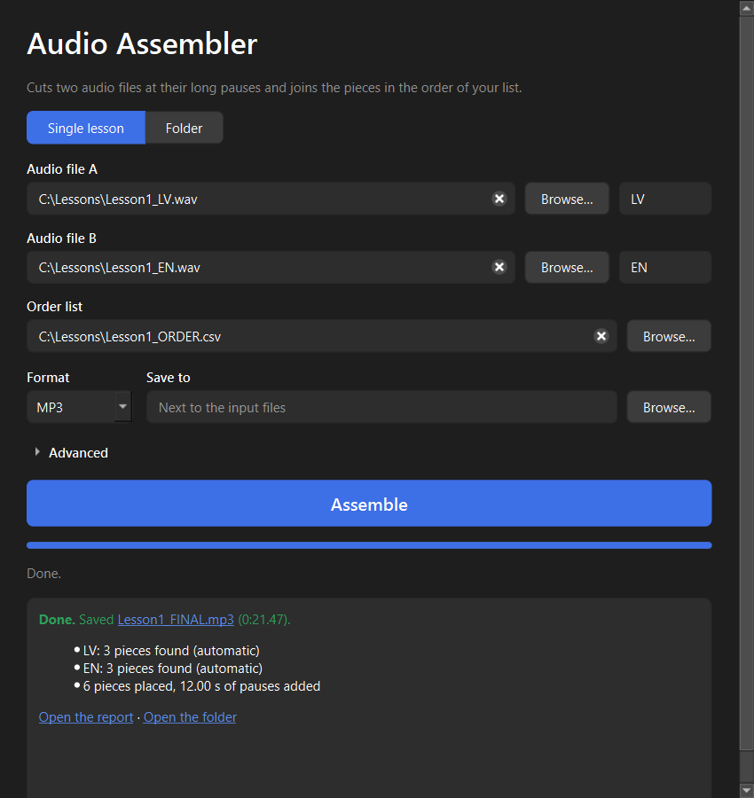

# Audio Assembler

Audio Assembler builds one finished audio file from two separate audio files and an order list.

Each input file contains spoken pieces separated by long silences. Audio Assembler finds those silences, cuts each file into numbered pieces (segments), and joins the pieces in the order given by the order list, with the exact pause you choose after each piece.

Typical use: bilingual lessons made with a text-to-speech service that can only produce one language per file. You make one file per language, put a long pause between the sentences, and let Audio Assembler interleave them.



## Install (Windows 10 and 11)

1. Download `AudioAssembler-<version>-Setup.exe` from the [Releases page](https://github.com/formful-dev/audio-assembler/releases).
2. Run it. It installs for your user account only, without administrator rights, and adds a desktop shortcut.
3. If Windows shows **"Windows protected your PC"**, click **More info**, then **Run anyway**. This message appears because the app is not signed with a paid certificate.

Nothing else is needed. Python, ffmpeg and everything else are included.

To uninstall, use **Settings > Apps > Installed apps > Audio Assembler**.

## How to use

### One lesson

1. Choose **Audio file A**, **Audio file B** and the **Order list**: click **Browse**, or drag the files onto the window. You can drop all three at once.
   - If the files are named like `Lesson1_LV.mp3`, `Lesson1_EN.mp3` and `Lesson1_ORDER.csv`, choosing one of them fills in the other two.
2. Check the **labels** next to the audio files. They are filled in from the end of the file name (`_LV` gives `LV`) and must match the labels in the order list.
3. Choose the **Format** (MP3 or WAV) and, if you like, another **Save to** folder. By default the result is saved next to the input files.
4. Click **Assemble**.

The result is `<name>_FINAL.mp3` (for example `Lesson1_FINAL.mp3`) plus a short report, `<name>_FINAL_report.txt`. The report lists the settings used, every piece found with its start and end time, the cut silences, any warnings, and the total duration.

The input files are never changed.

### A whole folder

1. Switch to **Folder** and choose the folder.
2. Every lesson in the folder needs three files whose names start the same way:
   `Lesson1_LV.mp3`, `Lesson1_EN.mp3`, `Lesson1_ORDER.csv`. The endings can be changed under **Advanced**.
3. Click **Assemble**. Every lesson gets its own result: **Done**, **Warning** or **Error**, with the reason. One failed lesson never stops the others. A summary is saved as `_batch_summary.txt`.

## The order list

The order list is a CSV file with 4 columns, in this order:

| Column | Meaning |
|---|---|
| order | Position in the finished file. Rows are played from the lowest to the highest number. Each number may be used once. |
| label | Which audio file the piece comes from, for example `LV` or `EN`. Must match a track label. Upper or lower case does not matter. |
| segment | Number of the piece within that audio file, counting from 1. A piece may be used more than once. |
| gap | Pause in seconds after the piece. `0` or more, decimals allowed. |

Example ([examples/Lesson1_ORDER.csv](examples/Lesson1_ORDER.csv)):

```
order,language,segment,gap_seconds
1,LV,1,2
2,EN,1,3
3,LV,2,1.5
4,EN,2,3
5,LV,2,0
```

- The header row is optional. The column names can be anything.
- Comma, semicolon or tab separators all work. Excel in many countries saves CSV with semicolons; that is fine.
- Decimal point or decimal comma both work (`1.5` or `1,5`). With commas as separators, use a decimal point, or save the file with semicolons.
- UTF-8 with or without BOM is fine.

Before saving anything, Audio Assembler checks the list. It stops with a clear message if a row is incomplete, a number is invalid, an order number is used twice, a label is unknown, or a row asks for a piece that does not exist (for example: *Row 4 (order 4): EN segment 8 does not exist. EN has only 7 segments.*). If some pieces are never used, it warns you and asks before saving.

## How the cuts are found

Each audio file is cut at its **long** silences. Short pauses between words and sentences are never cut.

- **Silence at the very start and end** of a file is ignored. It does not create an empty piece.
- Each piece is trimmed to its sound with a **safety margin** of silence kept on both sides (0.1 s by default), so no speech is clipped.
- A very short **fade** (5 ms by default) at every cut prevents clicks.
- The gap from the order list is added after each piece, exactly. Speed, pitch and content are never changed.
- If the two files have different sample rates or channel counts, both are converted to the higher of the two.

### Settings (Advanced)

| Setting | Default | What it does |
|---|---|---|
| Minimum silence for a cut | Automatic | Silences at least this long are cut points. **Automatic** measures all pauses in the file and finds the clear difference between normal speech pauses and the longer cut pauses. **Manual** lets you enter any value, for example `0.5`, `2` or `15`. |
| Silence level | Automatic | Sound quieter than this counts as silence. **Automatic** sets it from each file's background noise. |
| Safety margin | 0.1 s | Silence kept before and after each piece. |
| Fade length | 5 ms | Fade in and out at every cut. |
| Match loudness | Off | Turns the louder file down to the loudness of the quieter one (EBU R128). |
| Folder mode file endings | `_LV`, `_EN`, `_ORDER` | How lesson sets are recognised in folder mode. |
| Save lessons that have warnings | On | In folder mode, whether lessons with warnings are saved (marked "Warning") or skipped. |

Each file is analysed separately, because the two files may differ. When an order list is loaded, it is used to confirm the result: the number of pieces found must cover the highest piece number the list uses for that file.

If Automatic cannot clearly tell cut pauses from speech pauses, it stops, shows the longest pauses it found, and asks you to set **Minimum silence for a cut** manually. Pick a value between the speech pauses and the cut pauses. Example: if speech pauses are below 0.9 s and cut pauses are around 15 s, any value from 2 to 10 works.

## Troubleshooting

| Message or problem | What to do |
|---|---|
| *Could not find the cut points automatically* | Open **Advanced**, choose **Manual** for "Minimum silence for a cut", and enter a value between the speech pauses and the cut pauses listed in the message. |
| *The order list asks for segments that do not exist* | The list and the audio do not match. Check that you chose the right files. If a cut pause was missed, the message lists the cut silences that were found; set a lower manual "Minimum silence for a cut". |
| *The order list uses label(s) ... but the audio files are labelled ...* | Change the label fields next to the audio files, or correct the labels in the order list. |
| *Some segments are never used* | Only a warning. Check the list; click **Save anyway** if it is intended. |
| *Could not read the audio file* | Check that the file plays in a media player. If it plays, convert it to WAV and try again. |
| *... because the file is open in another program* | Close the finished file in your media player and try again. |
| A piece starts or ends too abruptly | Increase the **Safety margin** in Advanced. |
| Background noise breaks the detection | Set **Silence level** to Manual, for example -45 dB. |
| Windows says "Windows protected your PC" | Click **More info**, then **Run anyway**. |

Settings and the last used folders are remembered between runs (`%APPDATA%\Audio Assembler\settings.json` on Windows).

## Command line

The Windows app also includes `audio-assembler.exe` for automation (in the installation folder, `%LOCALAPPDATA%\Programs\Audio Assembler`):

```
audio-assembler lesson Lesson1_LV.mp3 Lesson1_EN.mp3 Lesson1_ORDER.csv [--format wav] [--out FOLDER] [--yes]
audio-assembler folder LESSONS_FOLDER [--suffix-a _LV --suffix-b _EN --suffix-order _ORDER]
audio-assembler analyze Lesson1_LV.mp3        # show the pieces and pauses found in one file
```

Options for all commands: `--cut SECONDS|auto`, `--level DB|auto`, `--margin SECONDS`, `--fade-ms MS`, `--match-loudness`. Run `audio-assembler --help` for everything.
Exit codes: 0 done, 1 error, 2 stopped because of warnings (use `--yes` to save anyway), 3 some lessons in a folder failed.

## Run from source (Windows, macOS, Linux)

Requires Python 3.10 or newer and ffmpeg on the PATH (`brew install ffmpeg`, `sudo apt install ffmpeg`, or `winget install ffmpeg`).

```
git clone https://github.com/formful-dev/audio-assembler.git
cd audio-assembler
python -m venv .venv
.venv/bin/pip install -e ".[gui,dev]"        # Windows: .venv\Scripts\pip ...
.venv/bin/audio-assembler-gui                # the window
.venv/bin/audio-assembler --help             # the command line
.venv/bin/python -m pytest                   # the tests
```

The code is split into `src/audio_assembler/core` (all audio logic, no user interface) and `src/audio_assembler/gui` (the window). The tests generate audio with known pauses and segments.

### Build the Windows installer

Builds run automatically on GitHub Actions ([.github/workflows/build.yml](.github/workflows/build.yml)): tests on Windows, macOS and Linux, a small ffmpeg build, the app and the installer. To build locally on Windows:

```
.venv\Scripts\pip install -r packaging\requirements-build.txt
python packaging\get_ffmpeg.py                      # the small LGPL ffmpeg from the latest release
winget install JRSoftware.InnoSetup
powershell -ExecutionPolicy Bypass -File packaging\build_windows.ps1
```

## License

Audio Assembler is released under the [MIT License](LICENSE).

The Windows app includes FFmpeg with the LAME MP3 encoder (LGPL, built by [packaging/ffmpeg/build_ffmpeg.sh](packaging/ffmpeg/build_ffmpeg.sh) with only the audio parts the app needs), Qt for Python (LGPL), Python and NumPy. Their licenses are installed in the app's `licenses` folder; see [THIRD_PARTY_NOTICES.txt](packaging/licenses/THIRD_PARTY_NOTICES.txt). The exact source code of the bundled ffmpeg is attached to every release.
